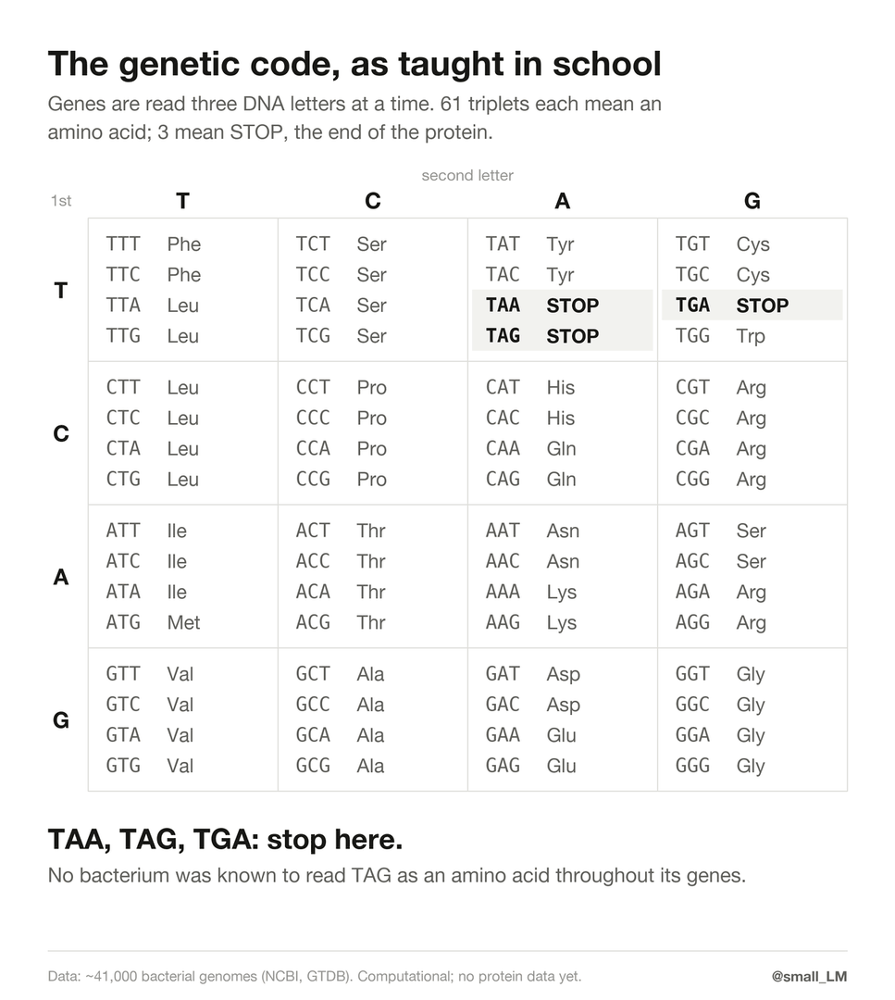

# Bacteria that read the stop codon TAG as an amino acid

Almost every gene ends in one of three stop codons: TAA, TAG or TGA. Bacteria were known to rewrite TGA into an amino acid
(tryptophan in *Mycoplasma*, glycine in Gracilibacteria), but never TAG.

We screened about 41,000 bacterial genomes and found 12, in six independent lineages, that read TAG as an amino acid across
the whole genome. Five of the six come from the guts of horses, Tibetan wild asses and a warthog. In three of them, TAG most
likely means glutamate.

## Status: please read first

- **AI-generated.** The screen, the analysis and the write-up were done by Claude (Anthropic) agents, run and curated by Ryan Xu.
- **Checked by AI, not yet by a human expert.** A second agent re-checked every lineage with a different method (tblastn
  against the raw genome DNA, no gene calls), and two more agents fact-checked the claims and searched for prior work.
- **Computational only.** The genomes were assembled from gut DNA by other groups (metagenome-assembled genomes, MAGs). None
  of these bacteria has been grown, and there is no protein data for them. The amino acid assignments are inferences.
- Corrections and criticism are very welcome: ryan@ryanxu.net.

### What was found?

| lineage | genomes | from | genes through TAG | through TAA / TGA | RF1 | TAG means |
|---|---|---|---|---|---|---|
| Aristaeellaceae, genus SFMI01 | 2 | horse (France), Tibetan wild ass | 92/181, 201/376 | 2–3 | deleted | glutamate |
| Aristaeellaceae, genus ZC3RG03 | 2 | horses (Inner Mongolia, Tibet) | 45/130, 58/131 | 5–6 | deleted | glutamate |
| Aristaeellaceae, genus JAUNDF01 | 1 | warthog (zoo, Germany) | 106/260 | 2–4 | deleted | glutamate |
| Aristaeellaceae, genus HGM11604 | 3 | Tibetan wild asses | 38–43 of 133–158 | 3–7 | present but broken | probably tryptophan |
| Lachnospiraceae, near UBA1267 | 2 | Tibetan horses | 347/690, 167/405 | 0–4 | deleted | glutamine |
| Victivallales, family UBA1829 | 2 | chicken (Ethiopia), red kangaroo (Australia) | 281/739, 181/484 | 0–5 | deleted | not yet known |

"Genes through TAG" counts, of the genes that end in TAG, how many make a protein that carries on past it and keeps matching
its relatives. The order matches the figures; `notes.md` numbers the lineages L1–L6 in the order they were found.

### How do we know TAG isn't a stop here?

- **It's only TAG.** In these genomes, 38 to 347 genes run straight through TAG, essential genes included (DnaA, RNA
  polymerase, EF-G). Through TAA or TGA it's 0 to 7, and in their closest relatives about zero.
- **The stop protein is gone.** All twelve lack a working release factor 1 (RF1, the protein that ends translation at TAG).
  Nine have deleted the gene; the three HGM11604 genomes keep a copy with its stop-recognition motif broken. Their closest
  relatives keep RF1 and use TAG as an ordinary stop.
- **Six separate times.** Each lineage sits among relatives that still stop at TAG, and each lost or broke RF1 in its own way
  (different deletion breakpoints; in HGM11604 a copy that decayed in place).
- **The TAGs are real.** Raw sequencing reads support them, and public horse-gut RNA data show the genes transcribed with
  their TAGs.

### How do we know what it means?

Where these bacteria have TAG, their relatives mostly have glutamate (three lineages) or glutamine (one), about as often as
at a real glutamate or glutamine codon in the same test. Several lineages also carry a new tRNA that pairs with TAG. The
tryptophan call is the weakest: only about half of its TAG sites look like tryptophan.

### What was known?

TAG is read as an amino acid across whole genomes in some single-celled eukaryotes (glutamine or glutamate), and in archaea
that read every TAG as pyrrolysine, a rare 22nd amino acid ([Kivenson, Banfield et al., *Science* 2025](https://doi.org/10.1126/science.adu2404)).
Earlier screens of bacteria ([Shulgina & Eddy 2021](https://elifesciences.org/articles/71402); Parks et al. 2026) found
stop codon changes only at TGA. Some bacteria use TAG for pyrrolysine, but only in a handful of genes.

### What would settle it?

Protein data. The archaeal code was confirmed by finding pyrrolysine in measured proteins; finding glutamate at TAG positions
in proteins from horse-gut samples would do the same here. No public metaproteome from equid guts exists yet.

### Files

- `notes.md`: the agents' full write-up (method, evidence, controls, checks, open points, references)
- `data/`: the 12 genomes (`genomes.tsv`), read-through counts, every TAG site with its relatives' residues, RF1 loci, tRNAs,
  read support, the independent re-checks, and the full screen; see [`data/README.md`](data/README.md)
- `src/`, `scripts/`: the analysis, runnable with `uv run`; `scripts/` downloads the large reference files
- `figures/`: the figures above and in `notes.md`
